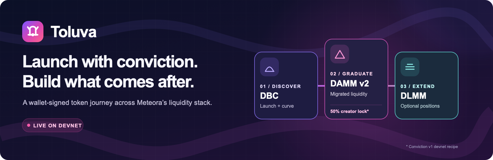
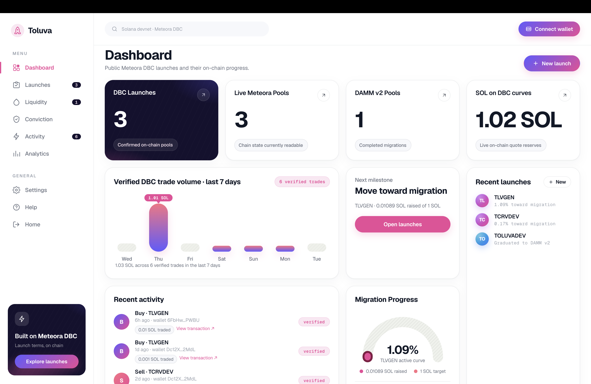
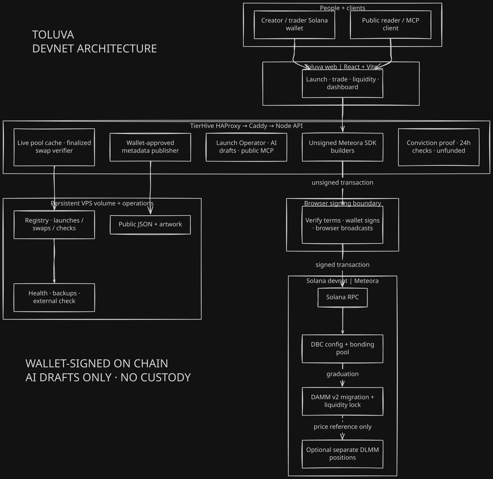

<p align="center">
  
</p>

# Toluva

**Launch with conviction. Build what comes after.**

[Try the live devnet app](https://devnet.toluva.xyz) · [Watch the demo](https://youtu.be/62Fx7H0jOck) · [Explore the architecture](#architecture) · [Inspect on-chain proof](docs/meteora-proof.md)

Toluva is a self-service token launch and liquidity experience built on Meteora. A creator launches through **Dynamic Bonding Curve (DBC)**, the token can graduate into **DAMM v2**, and the creator can open an optional **DLMM** market for wallet-owned liquidity positions. The app keeps the launch terms, live pool state, verified activity, and next step visible throughout that journey.

**Status:** the product is live on **Solana devnet** at [devnet.toluva.xyz](https://devnet.toluva.xyz). Mainnet is a release goal, not a current deployment.

## Table of contents

- [Project overview](#project-overview)
- [Product preview](#product-preview)
- [What Toluva does](#what-toluva-does)
- [A real devnet journey](#a-real-devnet-journey)
- [Architecture](#architecture)
- [How Meteora powers Toluva](#how-meteora-powers-toluva)
- [Launch Operator and public MCP](#launch-operator-and-public-mcp)
- [Verification and evidence](#verification-and-evidence)
- [Local setup](#local-setup)
- [Current limits](#current-limits)
- [Plans to go mainnet](#plans-to-go-mainnet)
- [Demo video](#demo-video)
- [Repository contents](#repository-contents)

## Project overview

Most launch tools focus on getting a token live. Toluva follows what happens next: price discovery on the curve, graduation, visible liquidity terms, participation, and an optional market where people can manage their own positions. The first supported recipe, **Conviction v1**, makes those mechanics understandable before a wallet signs.

Toluva was built for [Meteora's Dynamic Bonding Curve challenge](https://superteam.fun/earn/listing/meteora-dbc). Its working contribution is an end-to-end DBC → DAMM v2 → DLMM flow, including a creator-signed launch, wallet-signed trades, a verified migration, and separate DLMM deposits and withdrawals. The optional Conviction observation is an **unfunded** proof experiment; Toluva does not currently distribute rewards.

This repository began as the earlier Toluva Raydium LaunchLab + Torque project. The [original README](docs/torque-original-readme.md) and [original plan](docs/torque-original-plan.md) are preserved as history. Meteora-specific claims below are supported by the [new devnet proof](docs/meteora-proof.md).

## Product preview

<p align="center">
  <a href="docs/assets/toluva-devnet-dashboard.png"></a>
</p>

The public devnet dashboard, captured on October 13, 2026. Pool balances and activity change as people use the app; open the [live dashboard](https://devnet.toluva.xyz) for current figures.

## What Toluva does

1. **Prepare a launch.** Enter token details and artwork, or use the Launch Operator to draft editable fields from an idea. Review the fixed Conviction v1 economics and the graduation target.
2. **Publish metadata and sign.** A creator can publish wallet-approved, content-addressed JSON and artwork through Toluva or bring an existing public HTTPS metadata URI. Their wallet signs the DBC config and pool transactions; interrupted launches can be resumed.
3. **Trade on the curve.** Buyers and sellers review exact-input DBC quotes, slippage, and minimum received before signing. The public page reads the pool and config from Solana rather than treating the launch record as the source of truth.
4. **Follow graduation.** When the target is reached, the page shows the migration step. After the wallet-signed migration, it verifies the DAMM v2 pool, creator position, configured fees, and permanent liquidity lock.
5. **Manage optional DLMM liquidity.** The creator can open and link a separate DLMM pool using the graduated DAMM v2 price as a reference. Any connected wallet can review a position deposit and later withdraw its own liquidity.
6. **Inspect the evidence.** Dashboard and launch pages show live progress, submitted and verified DBC activity, linked liquidity, and relevant Solana explorer links. The public MCP endpoint offers launch terms and reports to other tools.

Wallet signing stays in the browser. The API builds unsigned transactions and verifies confirmed on-chain results; Toluva does not hold creator or trader private keys.

## A real devnet journey

The **Toluva Conviction Devnet** (`TOLUVADEV`) launch is the complete lifecycle example. These are confirmed devnet records, not simulated screenshots:

| Stage | Public evidence |
| --- | --- |
| DBC config and token pool | [Config](https://explorer.solana.com/address/HtBivi8K1mfroTVMZWGA4bg6uXuBo4c61KJ3mQGXBsWt?cluster=devnet) · [Pool](https://explorer.solana.com/address/DFxmgj3i6rRsf1p13FxuvKELZ3Ktk5MVGLNcKPu8Kbaa?cluster=devnet) · [Launch transaction](https://explorer.solana.com/tx/2i38qMtv5ziBBvrTTEXxyDPz4EP8Q5zjqxBxrgN7mJWq7CFU1VjqKLrSyrUv3Cg83K1WN95EDX5vyUCVbuTwMzZA?cluster=devnet) |
| Curve trade and graduation | [First buy](https://explorer.solana.com/tx/29XnbAi5CexW8zEJMZ9KGedCrhf8Mmv3i5Pvffwebfdv6ZvjYmcUUjN1NaJY2dbZbHANwby3eUNeZSVrksuUHpHa?cluster=devnet) · [Graduation buy](https://explorer.solana.com/tx/2iz64DoQaUkCTRcGKrsgs7Wkgw2NfQYQdjfAPfNPynfZ9zfVQDNr47qntLju9597C2hRW6aZx2ba47TvuAMRcWAs?cluster=devnet) |
| DAMM v2 migration | [Migration transaction](https://explorer.solana.com/tx/3CCd61o97tHar7LJV8A8pCxYceR9H3GA6JGjruC3kNx9tw6QSUcqAjUnL6c6uS9WkYJ1bxmkibUJSW3Y6WXBGqXA?cluster=devnet) · [Migrated pool](https://explorer.solana.com/address/3PUTDKRphNrbXw8MtVa1HvFBGek2fS6NEDM1tyZogbsj?cluster=devnet) |
| Optional DLMM market | [Pool creation](https://explorer.solana.com/tx/LDeGUTVbLNUZkA3tUWYoxbaM6SUhjpX5YnYSXvhfQCm3tmi8E3yquwaDkwxamvn3Jf1ScqxnZtoZ7VWQqGzQSGJ?cluster=devnet) · [Pool](https://explorer.solana.com/address/28fcUFiSqtMJxgwRGQw4G8dyUZGjnSXqmzq6KQxeE4U3?cluster=devnet) · [Creator deposit](https://explorer.solana.com/tx/5KoMXgN5V3gzGZ6jfbpd4ipPcqfZCtLjdRerJEoPPGfpYUUWbBZsyeEJa21MEnDU7cPQ5wY5LfXWLh9rPkduBNmF?cluster=devnet) |
| A second wallet's position | [Deposit](https://explorer.solana.com/tx/3iq6yPuh4e7GiedYAJZUUojSb5yWQaXDkL6ntKvzCQ5UR49bTWhbv1zKkjAXu2aFE4myFk1co9iMNXYiPfLQQryA?cluster=devnet) · [Full withdrawal](https://explorer.solana.com/tx/2L9wFWdpdnrdTgEhaMW5wRkBtrWM2ipEkYpnanCmU6q5bkgdww1vd3MBGcBn4Z4aib7pbp2KaGojqPxfLkrxenah?cluster=devnet) |

[Open this launch in Toluva](https://devnet.toluva.xyz/launches/TOLUVADEV-4ERL2SK1EUDAI3YUBDFQT2XX46X5WFPN7N3XMN9QSDTJ) · [Read the full transaction-by-transaction proof](docs/meteora-proof.md)

The second wallet belongs to the same tester. It verifies a distinct-address flow, not independent adoption or durable market depth.

## Architecture

<p align="center">
  <a href="docs/architecture/toluva-devnet-architecture.svg"></a>
</p>

[View the original SVG export](docs/architecture/toluva-devnet-architecture.svg) · [Open the editable Excalidraw source](docs/architecture/toluva-devnet-architecture.excalidraw)

The React app is served behind TierHive's HTTPS routing and a Caddy web container. A separate Node API serves public data, content-addressed metadata, launch guidance, and unsigned Meteora SDK transactions. A persistent VPS volume stores the launch registry, submitted verified swaps, Conviction checkpoints, JSON, and artwork. Backups and health checks cover that volume. The browser reviews terms, holds generated signers, asks the connected wallet to sign, and broadcasts to Solana devnet. The API rereads pool and config state from chain.

The **trust boundary** is deliberate: AI drafts and MCP tools cannot sign, broadcast, or take custody of assets. The optional DLMM pool is separate from the DAMM v2 migration; Toluva does not move DAMM v2 liquidity into DLMM automatically. See the [deployment guide](docs/tierhive-deploy.md), [operations guide](docs/tierhive-operations.md), and [API reference](docs/api.md).

## How Meteora powers Toluva

| Meteora component | Role in the product | What has been verified |
| --- | --- | --- |
| **DBC** | Configurable launch curve, SOL-quoted token pool, exact-input buys and sells | Creator-signed config/pool, wallet-signed buys and sell, on-chain terms and live progress |
| **DAMM v2** | Destination after the DBC target; successor pool and liquidity lock | Wallet-signed migration, enabled pool, creator position NFT and 50/50 creator liquidity split (to integer rounding) |
| **DLMM** | Optional, separate post-graduation pool with wallet-owned positions | Creator-signed pool link, deposits, full withdrawals, and a second-address deposit/exit |

The first recipe fixes a 1% DBC fee, 0.3% initial DAMM v2 fee, and 50% permanent lock of the migrated **creator liquidity**. The creator selects a 1–100 SOL devnet graduation target. The fee claimer and leftover receiver are the connected creator wallet; Toluva's configured partner fee is zero. Network rent and transaction fees still apply. Read the complete [Conviction v1 economic specification](docs/conviction-v1.md).

The [Meteora challenge](https://superteam.fun/earn/listing/meteora-dbc) specifically calls for creative flows using DBC, DAMM v2, and DLMM, as well as developer tooling. Toluva's live lifecycle and public read-only MCP address those areas. Toluva does **not** currently offer stock-paired launches, a curve preset marketplace, or arbitrary fee/curve configuration.

## Launch Operator and public MCP

The Launch Operator converts a plain-language launch idea into an **editable** Conviction v1 draft. It can also explain the next step of an existing launch using current pool state and verified activity. Server-side AI drafting is available on the hosted devnet app; guided field extraction works when the provider is unavailable. Unsupported economics remain blocked by server validation, and every launch still goes through the normal review and wallet flow.

The public [MCP endpoint](https://devnet.toluva.xyz/mcp) exposes `list_launches`, `get_launch_report`, `get_launch_terms`, `get_verified_activity`, `get_liquidity_market`, and `prepare_launch`. These tools return public information or an unsigned website handoff. They do not trade, create a token, or approve a transaction. See the [Launch Operator design and tool contract](docs/launch-operator.md).

## Verification and evidence

The proof record contains the chain links and checks for three Toluva-owned devnet launches, DBC buy/sell verification, a completed DBC → DAMM v2 migration, hosted metadata, and the DLMM pool/deposit/withdrawal path. Toluva verifies submitted DBC swap signatures against finalized transactions, the exact pool and mint, signer, and token balance changes. **Verified activity is not a complete market-wide index**: an RPC may omit older transactions from address history, so counts represent signatures Toluva has seen and checked.

An [unfunded Conviction trial](docs/conviction-checkpoints-v2.md) recorded two creator-wallet balance observations more than 24 chain hours apart. It demonstrates the checkpoint calculation, not uninterrupted holding, funded rewards, or third-party traction. The [funding and claim gate](docs/conviction-rewards-plan.md) remains open.

To reproduce the local checks:

```bash
npm test
npm run build
```

The [Meteora friction log](docs/meteora-friction-log.md) records issues found in the actual creator flow and the fixes. The [independent devnet pilot guide](docs/independent-devnet-pilot.md) describes the next external test.

## Local setup

Requires **Node.js 20+** and a Solana browser wallet configured for **devnet**.

```bash
git clone https://github.com/Pavilion-devs/toluva-torque.git
cd toluva-torque
npm ci
cp .env.example .env
npm run dev
```

Open `http://localhost:5173`; the local API runs on port `8787`. Set `SOLANA_CLUSTER=devnet` and a devnet `SOLANA_RPC_URL` for the API. If needed, set `VITE_SOLANA_RPC_URL` for the browser to an RPC on the **same** cluster. Keep provider keys server-side. A wallet needs devnet SOL for account rent and network fees. The current launch builder intentionally rejects non-devnet config and pool creation.

For a real token launch, configure [persistent metadata hosting](docs/metadata-hosting.md) or provide an existing public HTTPS token JSON URI. The [TierHive deployment guide](docs/tierhive-deploy.md) covers the current public host; it is more than a one-command frontend deployment because the registry and metadata URLs must persist.

## Current limits

- Toluva runs on **devnet only**. Mainnet assets and funded incentives are not enabled.
- Conviction v1 is one deliberately fixed launch recipe. It does not offer arbitrary curve shapes, quotes, fees, or stock/RWA pairs.
- The Conviction leaderboard uses recorded finalized balance checkpoints. It does not prove continuous holding between them, and there is no funded claim flow.
- DLMM liquidity is optional and user supplied. A linked pool or a small pilot position does not guarantee depth, trading fees, or returns.
- The public pilot has creator-operated and second-address tests, but no claim of unrelated-user adoption or production security review. See the [liquidity pilot's release notes](docs/dlmm-liquidity-v1.md).

## Plans to go mainnet

Toluva's mainnet path is a set of **release gates**, not a date or a claim that the devnet pilot is production ready:

1. **Harden the money paths.** Resolve or document reachable dependency advisories, review transaction construction and wallet signing boundaries, get an independent security review, and repeat complete launch/trade/migration/liquidity tests against release candidates.
2. **Make public data durable.** Move the registry and metadata to a resilient, backed-up production setup; rehearse restore and URL continuity; use reliable Solana RPC/indexing with reconciliation for missed swaps and stale pool reads.
3. **Prove use beyond the team.** Have an unaffiliated creator launch through the normal UI and independent wallets trade, deposit, and exit. Measure failure rates, fees, completion, and liquidity quality before setting mainnet defaults.
4. **Review economics and operations.** Validate mainnet curve and graduation targets, keeper/migration behavior, fee and lock disclosures, support and incident procedures, and the legal/operational requirements for any tokenized asset class offered.
5. **Gate rewards separately.** If a funded Conviction campaign is launched, define funding custody, eligibility, sybil resistance, claims, expiry, and recovery before any reward language or wallet action goes live.
6. **Ship a network-specific release.** Add deliberate mainnet configuration, deployment isolation, monitoring, and a small initial rollout; keep devnet available for public reproduction.

The tracked [build plan](plan.md), [reward gate](docs/conviction-rewards-plan.md), and [operations guide](docs/tierhive-operations.md) carry more detail. We will update this section as each gate is met.

## Demo video

[Watch the Toluva demo on YouTube](https://youtu.be/62Fx7H0jOck). It walks through the product, the real devnet launch lifecycle, the architecture, and the wallet-controlled liquidity path. Edited pacing and narration do not replace the linked on-chain evidence above.

## Repository contents

| Path | Purpose |
| --- | --- |
| `src/` | React app, dashboard, launch pages, wallet flow, and user-facing errors |
| `server/` | Node API, Meteora transaction builders, on-chain verification, Launch Operator, and MCP |
| `tests/` | Economic, transaction, metadata, registry, activity, and UI checks |
| `deploy/` | Isolated devnet container and web-proxy configuration |
| `docs/` | Architecture source and exports, proof records, economics, deployment, and pilot guides |
| `plan.md` | Working plan and release gates for the Meteora pivot |

The banner is a repo-native SVG design with a PNG GitHub preview; its [editable source](docs/assets/toluva-readme-banner.svg) is included. The architecture was drawn in Excalidraw and its editable source is included above. AI assistance was used in development and the demo's production. The earlier Raydium/Torque work remains in `docs/` for provenance.
