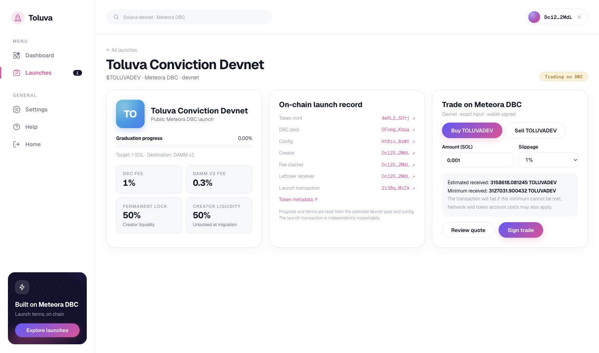

# Meteora DBC integration friction

These are issues encountered during the Toluva devnet build and normal wallet flow. The older Raydium/Torque [friction log](friction-log.md) belongs to the prior project.

## Confirmed config read blocked pool construction

- **Symptom:** After the creator signed a valid DBC config, pool construction failed with `Cannot read properties of undefined (reading 'poolFeeBps')`.
- **Root cause:** The SDK's config builder input has a nested `migratedPoolFee`, while the decoded on-chain `PoolConfig` exposes `migratedPoolFeeBps` at the top level. Our reader reused the builder shape for the on-chain account.
- **Resolution:** Decode and verify the on-chain shape explicitly before building the pool. Preserve the confirmed config and resume with a new mint signer. The pool transaction subsequently simulated and was confirmed. The [confirmed account fixture](../tests/fixtures/devnet-conviction-config.json) guards this mapping.

## Live pool status failed before the first trade

- **Symptom:** The token page briefly showed `Live pool state is unavailable: fetch failed` and stopped displaying fresh graduation progress.
- **Root cause:** The API was running, but its Solana devnet RPC connection was refused. On the development machine, the system resolver returned `64.130.42.134` for `api.devnet.solana.com`; independent resolvers returned `208.115.212.49`, which answered the same RPC health request over HTTPS. Other websites were reachable. This was a local DNS resolution failure, not a missing pool or failed launch.
- **Local resolution:** The Wi-Fi DNS servers were set to `8.8.8.8` and `1.1.1.1`. The API then read the same confirmed pool and quoted the buy again.
- **Product behavior:** A failed read now carries the last verified pool state with a stale marker and timestamp. The page pauses trading, discards a previously reviewed quote, explains the RPC outage, and offers a retry. A separate API outage preserves the last loaded registry instead of replacing the user's launches with static fallback data. Fresh chain data is required before trading resumes.
- **Validation:** An isolated RPC fault test served a fresh pool state, then severed the RPC connection. The API returned the previous state with `liveStale: true`, a preserved `liveCheckedAt`, and a clear retry message. After restoring connectivity, the real devnet pool and buy quote returned successfully.

The first wallet-signed DBC buy succeeded after RPC access was restored. Its transaction and received token balance are recorded in the [proof record](meteora-proof.md).

## Pool transaction expired during wallet approval

- **Symptom:** The first Toluva Genesis pool attempt showed a raw simulation error ending in `Blockhash not found`. Metadata publication and config creation had already succeeded; the pool had not been created.
- **Root cause:** The API attached a recent Solana blockhash while building an unsigned transaction. The browser then waited for the user's wallet approval before submitting it. That elapsed time could exhaust the blockhash validity window. A public RPC load balancer can also return a node that has not caught up to the node that supplied the blockhash. The error came from transaction freshness, not token metadata or config economics.
- **Recovery observed:** The existing resume path kept the confirmed config and metadata, built a new pool transaction, and the user's second approval finalized the launch. The addresses and signature are in the [proof record](meteora-proof.md).
- **Fix:** For unsigned config, pool and trade transactions, the browser now fetches a blockhash immediately before wallet signing, submits with a minimum context slot, and checks expiry after signing. Migration retains its original blockhash because the API has already applied required NFT signer signatures. Network failures after submission keep the signed transaction ID available so a user can check its status before retrying. Public launch, trade, wallet and chain-read errors are translated into plain language; technical details remain available in developer tools and API logs. Automated tests cover the signing and expiry paths. A further live wallet test is still needed to validate this change in the deployed product.

## Shared devnet RPC rate limited public pages

- **Symptom:** After public deployment, the shared devnet RPC returned `429 Too Many Requests`. Pool cards showed delayed status, trading paused, and a migrated pool could appear as bonding because the error path retained its old registry label instead of deriving it from the last verified pool read.
- **Root cause:** Every browser requested the registry every ten seconds. Each request reread all registered DBC pools, and the Conviction proof path made another pool read every thirty seconds per open token page. Three pools and several viewers multiplied a single page view into concurrent Solana RPC calls. The SDK retried each `429`, amplifying the load.
- **Fix:** Public pool reads now share one server cache and one in-flight request per pool. Reads across pools are serialized, successful state is reused for one minute, and failed reads back off for ninety seconds while preserving the last verified state and time. Read-only Conviction proof uses the same cache and pauses new balance observations when pool status is stale. The server's DBC connection fails fast on `429` instead of multiplying retries. Cards derive their stage from the last verified state and label delayed status plainly. Trade execution and migration builds still require fresh chain reads. Automated cache tests cover coalescing, serialization, failure retention, and recovery.
- **Remaining limit:** The public Solana endpoint can still rate limit this VPS or other services sharing its network address. A dependable dedicated devnet RPC remains the deployment fix if throttling persists; caching alone does not establish guaranteed uptime.
