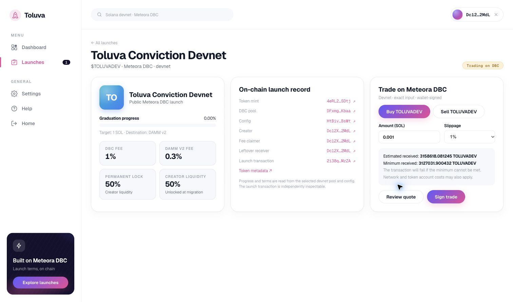
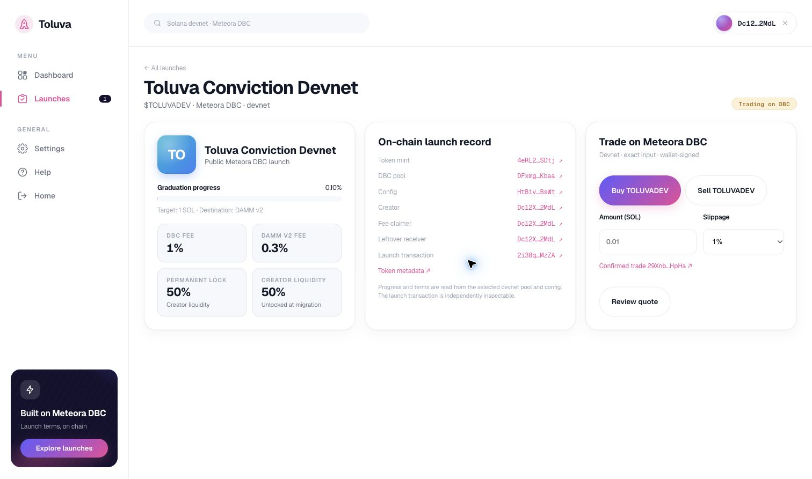
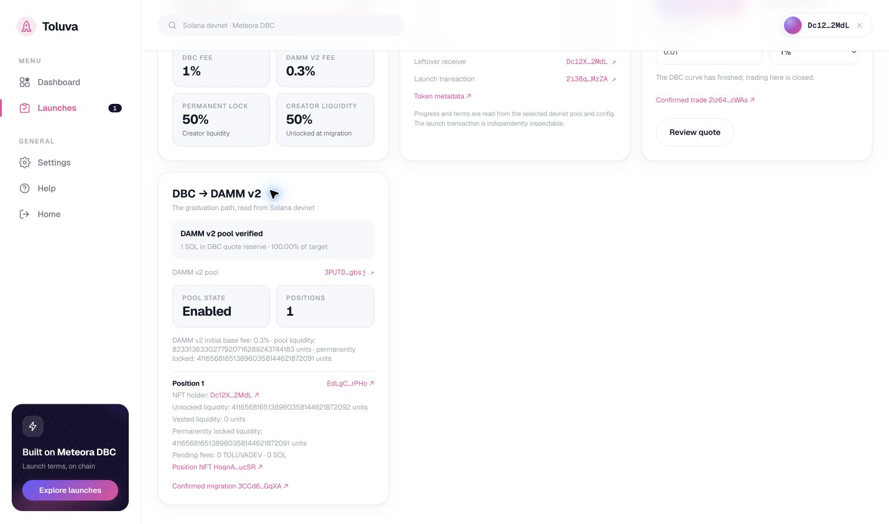

# Toluva Conviction devnet proof

This records Toluva-owned Meteora DBC pilots launched through the ordinary creator UI. A step is marked complete only after on-chain confirmation. The prior Raydium/Torque proof is separate.

## Pilot identity

- Name: Toluva Conviction Devnet
- Symbol: `TOLUVADEV`
- Network: Solana devnet
- [Public token metadata](https://cdn.jsdelivr.net/gh/Pavilion-devs/toluva-torque@8bc0ef6b6bce0dc4f3e46a28e7288d593524e796/public/metadata/toluva-conviction-devnet.json)
- Recipe: Conviction v1, SOL quote, 1 SOL migration threshold, 1% DBC fee, 0.3% DAMM v2 fee, 50% of migrated creator liquidity permanently locked

## Confirmed config

- Creator/fee claimer/leftover receiver: `Dc12XGCWDcnxpjDsYuz89vFqYJ4YHxYb3dvGFBC22MdL`
- [DBC config](https://explorer.solana.com/address/HtBivi8K1mfroTVMZWGA4bg6uXuBo4c61KJ3mQGXBsWt?cluster=devnet): `HtBivi8K1mfroTVMZWGA4bg6uXuBo4c61KJ3mQGXBsWt`
- [Confirmed createConfig transaction](https://explorer.solana.com/tx/534UTyVGR1LbCtiP5PThtHAEJ5cZnvu7y7LrymsFYTw6fPPy6L2reZMewgqmZbHvF9HtkxRDpAQXHiiUFPZt4iEb?cluster=devnet): `534UTyVGR1LbCtiP5PThtHAEJ5cZnvu7y7LrymsFYTw6fPPy6L2reZMewgqmZbHvF9HtkxRDpAQXHiiUFPZt4iEb`
- The SDK decoded the confirmed config with a 1,000,000,000 lamport threshold, 6 token decimals, fixed supply, immutable token authority, 100 bps DBC fee, 30 bps migrated-pool fee, and the 50/50 creator liquidity split.
- The exact on-chain account bytes are stored as a [regression fixture](../tests/fixtures/devnet-conviction-config.json). The verifier compares the account against the recipe before pool creation.

## Confirmed pool and mint

- [Token mint](https://explorer.solana.com/address/4eRL2sk1EUdAi3YuBDfqT2xx46X5WFpN7N3xmN9QSDtj?cluster=devnet): `4eRL2sk1EUdAi3YuBDfqT2xx46X5WFpN7N3xmN9QSDtj`
- [DBC pool](https://explorer.solana.com/address/DFxmgj3i6rRsf1p13FxuvKELZ3Ktk5MVGLNcKPu8Kbaa?cluster=devnet): `DFxmgj3i6rRsf1p13FxuvKELZ3Ktk5MVGLNcKPu8Kbaa`
- [Confirmed pool transaction](https://explorer.solana.com/tx/2i38qMtv5ziBBvrTTEXxyDPz4EP8Q5zjqxBxrgN7mJWq7CFU1VjqKLrSyrUv3Cg83K1WN95EDX5vyUCVbuTwMzZA?cluster=devnet): `2i38qMtv5ziBBvrTTEXxyDPz4EP8Q5zjqxBxrgN7mJWq7CFU1VjqKLrSyrUv3Cg83K1WN95EDX5vyUCVbuTwMzZA`
- The verifier checked the pool PDA, its on-chain config/mint/creator relationship, creator and mint signatures, and the `initializeVirtualPoolWithSplToken` instruction in that transaction. The instruction metadata matches the name, symbol and URI above.
- Before the first trade, an on-chain status read showed bonding state, zero quote reserve, zero migration progress and 0.00% of the 1 SOL threshold. A read-only exact-input quote for a 0.001 SOL buy returned successfully.
- An unsigned 0.001 SOL buy built for the connected wallet simulated on devnet with no error (46,941 compute units) before wallet signing.
- The public Toluva launch page displays the mint, pool, config, creator, fees, migration target, lock terms, live progress and explorer links. The devnet product is now served at [devnet.toluva.xyz](https://devnet.toluva.xyz); this does not claim that the original `toluva.xyz` site hosts the new build.

## Confirmed first buy

- [Finalized DBC buy transaction](https://explorer.solana.com/tx/29XnbAi5CexW8zEJMZ9KGedCrhf8Mmv3i5Pvffwebfdv6ZvjYmcUUjN1NaJY2dbZbHANwby3eUNeZSVrksuUHpHa?cluster=devnet): `29XnbAi5CexW8zEJMZ9KGedCrhf8Mmv3i5Pvffwebfdv6ZvjYmcUUjN1NaJY2dbZbHANwby3eUNeZSVrksuUHpHa`
- The connected creator wallet `Dc12XGCWDcnxpjDsYuz89vFqYJ4YHxYb3dvGFBC22MdL` signed the transaction. It succeeded at slot `508861735` with no transaction error and invoked the Meteora DBC program against this pool and mint.
- The pool received `0.001` SOL in its quote token account. The wallet's TOLUVADEV token account received `3,158,618.081245` tokens, exactly matching the reviewed output. The transaction fee was `80,000` lamports; token-account creation and other network costs can also affect the wallet's SOL balance.
- A fresh pool read showed `990,000` quote-reserve lamports after fees, `0.10%` graduation progress and migration progress `0` (still bonding). This is buy execution evidence, not graduation evidence.

## Confirmed graduation buy

- The normal trade UI reviewed a `1.009101011` SOL buy. Its unsigned transaction simulated without error, with a predicted post-trade DBC quote reserve of exactly `1,000,000,000` lamports. The reviewed quote is captured in [graduation-quote-review.png](graduation-quote-review.png).
- The connected wallet signed the [graduation buy transaction](https://explorer.solana.com/tx/2iz64DoQaUkCTRcGKrsgs7Wkgw2NfQYQdjfAPfNPynfZ9zfVQDNr47qntLju9597C2hRW6aZx2ba47TvuAMRcWAs?cluster=devnet): `2iz64DoQaUkCTRcGKrsgs7Wkgw2NfQYQdjfAPfNPynfZ9zfVQDNr47qntLju9597C2hRW6aZx2ba47TvuAMRcWAs`. It finalized at slot `508902782` without an error.
- A fresh chain read showed the 1 SOL threshold reached, `100.00%` progress and migration progress `2` (`LockedVesting`). DBC trading closed while DAMM v2 migration was pending. These are observed post-transaction states, not simulation claims.

## Confirmed DAMM v2 migration

- The wallet-signed [migration transaction](https://explorer.solana.com/tx/3CCd61o97tHar7LJV8A8pCxYceR9H3GA6JGjruC3kNx9tw6QSUcqAjUnL6c6uS9WkYJ1bxmkibUJSW3Y6WXBGqXA?cluster=devnet): `3CCd61o97tHar7LJV8A8pCxYceR9H3GA6JGjruC3kNx9tw6QSUcqAjUnL6c6uS9WkYJ1bxmkibUJSW3Y6WXBGqXA` finalized at slot `508927655` without an error.
- The derived [DAMM v2 pool](https://explorer.solana.com/address/3PUTDKRphNrbXw8MtVa1HvFBGek2fS6NEDM1tyZogbsj?cluster=devnet) `3PUTDKRphNrbXw8MtVa1HvFBGek2fS6NEDM1tyZogbsj` exists on devnet under the DAMM v2 program. Toluva's chain reader verifies it is enabled and reads the configured `0.3%` initial base fee.
- The chain reader found [position](https://explorer.solana.com/address/EdLgChkFkJoCQNVMdmxTMG6M6o5kcAd1KQwzxjRNrPHo?cluster=devnet) `EdLgChkFkJoCQNVMdmxTMG6M6o5kcAd1KQwzxjRNrPHo`, whose [NFT](https://explorer.solana.com/address/HoqnASbSjhXEfW6v8U5KT6RdSZ8471UR2qmXY4CuucSR?cluster=devnet) is held by creator wallet `Dc12XGCWDcnxpjDsYuz89vFqYJ4YHxYb3dvGFBC22MdL`. The position reports `4116568165138960358144621872092` unlocked liquidity units and `4116568165138960358144621872091` permanently locked units, matching the recipe's 50/50 split to integer rounding. These are DAMM liquidity units, not token or SOL amounts.
- Before the user signed, the migration transaction was built for this pool and simulated on devnet without an error (`144,370` compute units). The migration UI now displays the verified successor pool, position owner, lock state and confirmed transaction through the ordinary token page.

## Next evidence

- Both pilot buy signatures independently pass Toluva's finalized DBC swap verifier. It checks the DBC `swap2` instruction, exact pool and mint, signer, and opposing wallet/pool token balance changes. The public page now reports **2 verified buys by 1 tracked buyer**, each linked to its transaction. Re-submitting the same signature leaves the event count at two. The devnet RPC returned the first buy by direct signature lookup while omitting it from that pool's address-history listing, so Toluva records verified submitted signatures and does not present its count as a complete chain index.
- The [unfunded graduation checkpoint v1](conviction-proof-v1.md) reads the pilot's current finalized token balance and verified DAMM v2 state. The tracked wallet meets its 0.01 SOL buy and 1 token balance rules at the recorded read slot. This is a current-state proof, not an uninterrupted-hold or reward claim.
- The [Conviction checkpoints v2](conviction-checkpoints-v2.md) recorded two finalized post-migration observations for creator wallet `Dc12XGCWDcnxpjDsYuz89vFqYJ4YHxYb3dvGFBC22MdL`. Entry was at devnet slot `509519885`, chain time `2026-10-10T11:05:27Z`; follow-up was at slot `509881479`, chain time `2026-10-11T11:05:50Z`, **86,423 seconds** later. Both observations read `799999895873530` raw units of TOLUVADEV across [token account `G8Qm…NNTg6`](https://explorer.solana.com/address/G8Qm7wzmVq99rdRychUGRJ3RL8qvriZi19jjn7aNNTg6?cluster=devnet). The public leaderboard now scores this wallet **2/2, eligible under the unfunded proof policy**, with the [qualifying graduation buy](https://explorer.solana.com/tx/2iz64DoQaUkCTRcGKrsgs7Wkgw2NfQYQdjfAPfNPynfZ9zfVQDNr47qntLju9597C2hRW6aZx2ba47TvuAMRcWAs?cluster=devnet). Historical balance observations are stored server readings of finalized RPC state, not standalone transaction receipts or proof of continuous holding.
- A wallet-signed DBC sell on a still-active curve is confirmed in the second pilot below.
- Independent creator reproduction, a two-wallet campaign observation, and funded reward claim: pending. The 24-hour checkpoint interval was completed by the creator wallet alone. General-purpose metadata hosting is live on the public devnet site and was used for the Genesis launch below.

The first pool build attempt exposed a schema mapping error: the SDK builder accepts nested `migratedPoolFee`, while decoded on-chain `PoolConfig` stores `migratedPoolFeeBps` at the top level. The confirmed config was unaffected. The reader now uses the on-chain field, and an unsigned pool transaction using this config passed devnet simulation before the successful wallet-signed launch.

## Active-curve buy and sell reproduction

- A second ordinary UI launch created **Toluva Curve Trial** (`TCRVDEV`) with a 5 SOL graduation target and [public metadata](https://cdn.jsdelivr.net/gh/Pavilion-devs/toluva-torque@fdf6e9a21e1a517de43e659c21d672135a469b47/public/metadata/toluva-curve-trial.json). The [token mint](https://explorer.solana.com/address/FERu2ZM2ADAMGSJrrVP9HECfx8Rr2Q9Ws71TeZochW3R?cluster=devnet) is `FERu2ZM2ADAMGSJrrVP9HECfx8Rr2Q9Ws71TeZochW3R`, the [DBC pool](https://explorer.solana.com/address/3umwkNC6ETLvMBdRnYi5Ls4zPQeEMXRdjDHDtSvKKjrr?cluster=devnet) is `3umwkNC6ETLvMBdRnYi5Ls4zPQeEMXRdjDHDtSvKKjrr`, and the [config](https://explorer.solana.com/address/3kirocb6pw5PL6KthFL9QPKDa4cqeQSXY2GmJo4hS89E?cluster=devnet) is `3kirocb6pw5PL6KthFL9QPKDa4cqeQSXY2GmJo4hS89E`. The [pool launch transaction](https://explorer.solana.com/tx/de9EKQpzvwMMHnsoZUBR56yJEGPoYWrXZ1XYFg1wCxaHgQfWZt4Q1YMLMGYW7ZJQrHsShoJVqv2zGEQCEuvr89B?cluster=devnet) finalized at slot `509514432` with no error.
- The connected wallet bought with `0.01` SOL through the normal trade UI. The [buy transaction](https://explorer.solana.com/tx/5xfCLRv6dxAUD7x22pcBruyPMoiqP6jsDSfce9nNKYbD37MG4U5nhyqrRdXAkkH1BbCHzAPAC23ZQEFfbxYZAVGf?cluster=devnet) finalized at slot `509515508` with no error. The wallet's token account held `6,298,585.666442` TCRVDEV afterward. Toluva independently verified and listed this buy.
- The wallet then sold `1,000,000` TCRVDEV while the curve remained open. The [sell transaction](https://explorer.solana.com/tx/3tP9budpr68VW3ZFQhjonHqT6RKP58J9UHYdAV1fnUaCm7nBTtVUTyQUS2ZNw86GFDWahBhLBNxaXgJTfBdmHttD?cluster=devnet) finalized at slot `509516061` with no error. Its Meteora DBC vault quote-token balance fell by `1,563,831` lamports, matching the reviewed `0.001563831` SOL output. The wallet's base-token balance fell by exactly `1,000,000` TCRVDEV to `5,298,585.666442` TCRVDEV. Toluva independently verified and listed this sell, while the pool still showed DBC trading at `0.17%` of the 5 SOL target.
- This sell exposed a verifier assumption: `swap2` uses the user destination account for the base token on buys and the user source account on sells. The temporary wrapped-SOL account on this sell was created and closed in the same transaction, so it had no before/after token balance entry. The verifier now reads the base-token balance from the appropriate user side, requires the owner signature and exact pool/mint, checks opposite vault changes, and requires the user's base change to match the pool's exactly. The finalized sell passed the corrected verifier, and the page reports **1 verified buy and 1 verified sell** for this pool.

## Public hosted-metadata launch

- On 2026-10-11, the normal creator flow published the artwork and JSON for **Toluva Genesis** (`TLVGEN`) through the public Toluva devnet service using a wallet-approved message. Its [public token metadata](https://devnet.toluva.xyz/metadata/tokens/0b71198bb6a158e5ad412f6b7cee6e0aae121f66c421c41019dac652e0971c52.json) and [artwork](https://devnet.toluva.xyz/metadata/images/70b827be49505eeab18d0f24aece87b26ff03ce34118b22a9166497515fe3fed.jpg) both returned successfully from the production hostname. The [launch page](https://devnet.toluva.xyz/launches/TLVGEN-BYZ9FJMNNJKRPVGPWGCCOTUZSLAODDKMKMDHWVP7CXGV) uses those same addresses and assets.
- The [mint](https://explorer.solana.com/address/BYZ9FJMNnjKRPvgpwGcCotuzSLAoDdKmKMdHWvp7cxgv?cluster=devnet) is `BYZ9FJMNnjKRPvgpwGcCotuzSLAoDdKmKMdHWvp7cxgv`, the [DBC pool](https://explorer.solana.com/address/AcTgyz3EgGbakaKxw2vSKpCYodTNrjXWmoz6WvV8iHMN?cluster=devnet) is `AcTgyz3EgGbakaKxw2vSKpCYodTNrjXWmoz6WvV8iHMN`, and the [config](https://explorer.solana.com/address/GcgG8iAgCym1Wcx4hhtasGfGac82i7Eg9uWiauahxsR3?cluster=devnet) is `GcgG8iAgCym1Wcx4hhtasGfGac82i7Eg9uWiauahxsR3`. The [pool creation transaction](https://explorer.solana.com/tx/5YWcDnmgCACfREsuwGe6QsQMcAp2g2ShryF4meiEzM3XKgXitDXmq3g7ALnp8rqFZDsEFUHbBnGK9NvFkehx7bU3?cluster=devnet) finalized at slot `509835691` without an error. The pool account is owned by the Meteora DBC program.
- The public API reread the config from chain: SOL quote, 1 SOL migration threshold, 1% DBC fee, 0.3% DAMM v2 fee, immutable fixed-supply token, and a 50/50 creator liquidity split with half permanently locked at migration. Its fresh pool read showed bonding at 0% progress and no tracked swaps as of 2026-10-11 08:26 UTC. This is a creator-operated launch, not independent user traction.
- The first pool submission was rejected during preflight because its blockhash was no longer found. The wallet-approved metadata and config remained saved; the ordinary **Resume token launch** flow built a fresh pool transaction, and the wallet-approved retry finalized. The browser transaction handoff now refreshes the blockhash immediately before signing and checks expiry before broadcast. Its trade path passed the live wallet test below; the updated config and pool paths have automated coverage but have not been repeated with another wallet-signed launch.
- After deployment of the transaction freshness and RPC load fixes, the same creator wallet reviewed and signed a normal `0.001` SOL TLVGEN buy on the public site. The [buy transaction](https://explorer.solana.com/tx/2sikeHr4FndR7wPcZpZHLcDwWSewj5niyzcYbKQtjtaR5toH4Aw73pDNuua8SdphpXrVuz1bv6XxwZKLMYXoorGi?cluster=devnet) finalized at slot `509846070` on `2026-10-11T08:45:08Z` without error. The wallet received `3,158,618.081245` TLVGEN, matching the reviewed estimate; the transaction fee was `80,000` lamports. Toluva independently accepted the signature as a DBC buy for this exact pool and mint and showed **1 verified buy by 1 tracked buyer** after refresh. A fresh pool read showed `990,000` quote-reserve lamports and `0.10%` of the 1 SOL graduation target. This proves the deployed creator-operated trade flow, not independent user adoption or a funded Conviction result. The `0.001` SOL buy is below the policy's `0.01` SOL qualifying minimum.

## Post-graduation DLMM pool

- On 2026-10-13, the TOLUVADEV creator used the new public launch-page flow to sign [DLMM pool creation](https://explorer.solana.com/tx/LDeGUTVbLNUZkA3tUWYoxbaM6SUhjpX5YnYSXvhfQCm3tmi8E3yquwaDkwxamvn3Jf1ScqxnZtoZ7VWQqGzQSGJ?cluster=devnet): `LDeGUTVbLNUZkA3tUWYoxbaM6SUhjpX5YnYSXvhfQCm3tmi8E3yquwaDkwxamvn3Jf1ScqxnZtoZ7VWQqGzQSGJ`. Solana returned finalized slot `510423819`, no transaction error, creator signer `Dc12XGCWDcnxpjDsYuz89vFqYJ4YHxYb3dvGFBC22MdL`, and the devnet Meteora DLMM program `LBUZKhRxPF3XUpBCjp4YzTKgLccjZhTSDM9YuVaPwxo` in the transaction.
- The creator then signed the off-chain pool-link message. Toluva verified the message, the derived [DLMM pool](https://explorer.solana.com/address/28fcUFiSqtMJxgwRGQw4G8dyUZGjnSXqmzq6KQxeE4U3?cluster=devnet) `28fcUFiSqtMJxgwRGQw4G8dyUZGjnSXqmzq6KQxeE4U3`, and its TOLUVADEV / wrapped-SOL mint pair before recording the link. The public API reports `exists: true`, `linked: true`, 10-bps bins, active bin `-12213` and empty token reserves.
- The creator reviewed and signed a 100,000 TOLUVADEV plus 0.0005 SOL position deposit. The [deposit transaction](https://explorer.solana.com/tx/5KoMXgN5V3gzGZ6jfbpd4ipPcqfZCtLjdRerJEoPPGfpYUUWbBZsyeEJa21MEnDU7cPQ5wY5LfXWLh9rPkduBNmF?cluster=devnet) `5KoMXgN5V3gzGZ6jfbpd4ipPcqfZCtLjdRerJEoPPGfpYUUWbBZsyeEJa21MEnDU7cPQ5wY5LfXWLh9rPkduBNmF` finalized at slot `510424768` without error. Both creator and newly generated position `FTo2NvcK9ttBih1r3nYDFqXRL2MyCWq6ENtK1gu2pPvu` signed it; the Meteora DLMM program ran.
- A fresh DLMM read found that position under the creator wallet with bins `-12223` through `-12203`, `99,999.999995` TOLUVADEV and `0.000499994` SOL in the pool, and no unclaimed fees. The slight difference from input is the actual SDK bin distribution and rounding.
- The creator signed [full withdrawal and close](https://explorer.solana.com/tx/3uQQT6RF1Z14WvD8xPrcoH6nHugARmdxKByrvwPqaExTNTA1yqZnJpw3wnyTNAkj7WGDNUyJJ4f8baYE5L6T13wA?cluster=devnet): `3uQQT6RF1Z14WvD8xPrcoH6nHugARmdxKByrvwPqaExTNTA1yqZnJpw3wnyTNAkj7WGDNUyJJ4f8baYE5L6T13wA`. It finalized at slot `510426297` without error, with the creator signer and DLMM program. Transaction token balances show the creator's TOLUVADEV account rose by exactly `99,999.999995` tokens while the pool's TOLUVADEV and wrapped-SOL balances fell to zero. The creator's native SOL balance rose by `0.042316902` SOL: `0.000499994` SOL liquidity plus `0.041899840` SOL position rent returned, less `0.000082932` SOL transaction fee. The position account `FTo2NvcK9ttBih1r3nYDFqXRL2MyCWq6ENtK1gu2pPvu` no longer exists at finalized commitment; a fresh DLMM read reports zero reserves and no wallet positions. This completes the creator-operated deposit/exit proof. It is not independent participation or evidence of sustained market depth.
- The creator then added a new position through the public page: [deposit transaction](https://explorer.solana.com/tx/NEpG4pe2DPmF7Wy5buviybZqAMp6iSNmzdQ7TTsyRgTQBE2YS3gJCJeUJ9wddy2TYctTVLiZtXpFQYZRGPmxCMM?cluster=devnet) `NEpG4pe2DPmF7Wy5buviybZqAMp6iSNmzdQ7TTsyRgTQBE2YS3gJCJeUJ9wddy2TYctTVLiZtXpFQYZRGPmxCMM`, finalized at slot `510427663` without error. Both the creator and new position `DKhfVzevm3ZDFHMe6AknpF7gKq62WXAGkjTDJfpWJZ6L` signed; the DLMM program ran. A fresh pool read shows `99,999.999995` TOLUVADEV and `0.000499994` SOL reserves, with that position in bins `-12223` to `-12203`. The public launch page displays those reserves to visitors. This is creator-supplied trial liquidity and may change; it does not prove independent adoption or durable depth.
